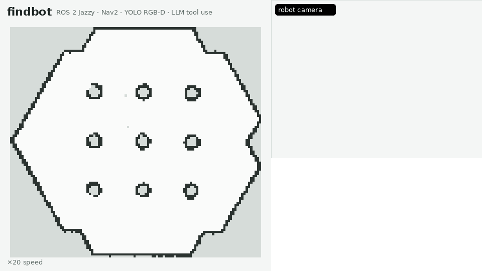
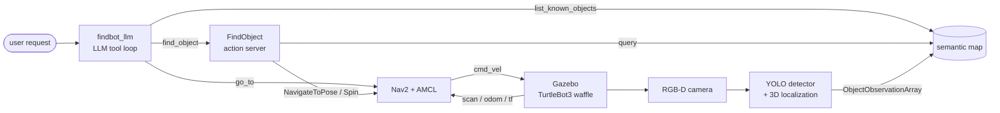

# findbot

**Ask a mobile robot to find something, in plain language.**
"Find the red fire hydrant" → an LLM picks a tool → the robot checks what it remembers,
explores the room if needed, recognizes the object with an RGB-D camera, and drives up to it.




<sub>A recorded run at 20× speed (`demo/record_demo.sh`, `demo/render_gif.py`): "Find the red fire hydrant",
then "Take me to the chair", starting from an empty memory. Left: the SLAM map with the robot, its trail,
the Nav2 plan and the objects it has remembered. Right: the robot's camera with YOLO detections, and the
conversation. Both backpacks in the arena end up labelled "person" in this run; see
[Limitations](#limitations-and-next-steps).</sub>

A simulated TurtleBot3 project that connects the main pieces of a modern mobile robot:
SLAM and navigation, 3D object perception, an object memory, a long-running search task,
and a language interface, each one tested against ground truth from the simulator.

A real run (`eval/run_eval.sh chat`, Zhipu `glm-4.7-flash`), with the chair not yet in memory:

```text
you: Take me to the chair
  → tool call find_object({"label": "chair", "color": "any"})
    [memory] do I remember a chair?
    [search] not in memory; searching far_side (1/4)
    [look around] looking around at far_side
    [search] not in memory; searching north (2/4)
    [look around] looking around at north
    [search] not in memory; searching home (3/4)
    [look around] looking around at home
    [approach] spotted it while searching home: chair at (0.95, -1.58); driving to it
🤖 I found a black chair at map coordinates (0.95, -1.58) and drove up to it,
   stopping in front of it after about 4 minutes.
```

## What it does

| Capability | How |
|---|---|
| Mapping and navigation | SLAM Toolbox builds the map; Nav2 with AMCL localizes and plans. Goals by name (`go_to north`). |
| 3D object detection | YOLO11n on the RGB image, median depth inside each box, pinhole back-projection, TF to the `map` frame, HSV colour name. |
| Object memory | A semantic map fuses detections over time, rejects false positives, keeps the best photo of each object, and survives restarts. |
| Search task | A `FindObject` ROS 2 action: use memory if possible, otherwise tour the room and look around, stop early when the object is seen, then approach it. |
| Language interface | An LLM tool-use loop (Zhipu GLM or Claude) maps requests in English, Korean or Chinese to three robot tools with validated arguments. |

## Architecture



The language model never produces coordinates. It can only call three tools whose
arguments are closed enums (the detector's 80 classes, colour names, named places), and
every call is validated in code before the robot moves. Map coordinates come from the
semantic map; motion comes from Nav2.

## Results

All numbers are from runs in simulation, measured against object and robot positions read
from Gazebo, not against the robot's own estimates.

**3D localization of detected objects** (patrol with the semantic map, two runs)

| Object | Position error | Colour |
|---|---|---|
| Fire hydrant | 8–9 cm | red ✓ |
| Chair | 11–16 cm | blue ✓ (black once, see below) |
| Person | 13–16 cm | blue (jeans) ✓ |
| Suitcase | 19–24 cm | blue ✓ |
| Red backpack | 22 cm | red ✓, but labelled "suitcase" |
| Blue backpack | not detected | — |

After filtering, every object in memory was a real one (0 false positives in 5); 61
detections that landed on mapped walls or pillars were rejected.

**FindObject action**: 4/4 scenarios behaved as expected (explore from empty memory, reuse
memory, fail cleanly when exploration is not allowed). The robot stopped 0.75–0.89 m from
the object (target 0.7 m, Nav2 goal tolerance 0.25 m).

**Language interface** with the free Zhipu `glm-4.7-flash` model:

| Test | Result |
|---|---|
| Tool choice, fake robot (`eval/probe_llm.py`): 9 requests in English, Korean and Chinese, 3 runs each | 26/27 (Korean 6/6). The miss: "Is there a blue box?" answered "cannot recognize boxes" instead of mapping *box* to *suitcase* |
| End-to-end in simulation (`eval/run_eval.sh chat`), 5 requests, one run in English and one in Chinese | 10/10 requests did the right thing |

In the end-to-end runs the robot stopped 0.74–0.79 m from the target three times, and once
1.18 m away: the chair had been seen only a few times from the side, its estimated position
was 22 cm off, and Nav2's 0.25 m goal tolerance added to that.

## Engineering notes

Problems found during development, and how they were tracked down:

- **A goal "succeeded" without the robot moving.** Returning home took 14 s where 2 minutes
  were expected. Comparing with Gazebo ground truth showed the robot had not moved:
  `BasicNavigator.waitUntilNav2Active(localizer="amcl")` re-publishes `/initialpose` at the
  map origin until it hears from AMCL, which reset the localization to "home". The CLI now
  only waits for the navigator. After the fix, 4/4 named places were reached within 9 cm.
- **Symmetric arena, ambiguous localization.** The TurtleBot3 world looks the same after a
  180° rotation. A deliberately wrong initial pose made AMCL settle on the mirror solution
  (`map → odom` rotated by 172°): the global planner saw free space where the local
  costmap saw a wall, and navigation stalled after 8 recoveries.
- **Detections that are really walls.** YOLO called pillars "refrigerator" and floor
  shadows "airplane". The static map was built before the objects were placed, so a
  detection that lands on a mapped obstacle is rejected; a detection must also be seen 3
  times, and when two labels compete for the same spot the more frequent one wins.
- **COCO bias.** The detector does not recognize a backpack lying on the floor, because
  COCO backpacks are almost always worn by people. An open-vocabulary detector is the
  planned fix.
- **Simulation cost.** The upstream camera (1080p at 30 Hz, CPU-rendered) used most of the
  CPU. A 640×480 RGB-D camera at 10 Hz cut Gazebo from 680 % to 190 % CPU; see
  [docs/setup-wsl.md](docs/setup-wsl.md).
- **Robot memory that survives crashes.** Memory was first saved only on shutdown and was
  lost when the process was killed. It is now written atomically every 10 s when it changes
  (verified with `kill -9`).
- **LLM evaluation pitfalls.** A first prompt sent the robot "home" when asked to go to the
  chair; the prompt now states which tool reaches objects. Outputs vary between runs, so
  each request is repeated and graded on all reasonable behaviours (answering "is there a
  box?" from memory is as correct as searching). The free model is rate-limited at busy
  times, so HTTP 429 is retried with backoff.

## Packages

| Package | Contents |
|---|---|
| `findbot_bringup` | Launch files (`sim`, `slam`, `explore`, `nav`, `perception_demo`, `system`), the robot model with an RGB-D camera, the world with objects, the saved map, Nav2 and RViz configuration |
| `findbot_interfaces` | `ObjectObservation(Array)`, `SemanticObject`, `QueryObjects.srv`, `FindObject.action` |
| `findbot_perception` | `object_detector` (YOLO + depth + TF), `semantic_map` (fusion, query service, persistence) |
| `findbot_behaviors` | `find_object_server`, `find` and `go_to` CLIs, a lidar `wanderer` |
| `findbot_llm` | `chat` CLI: LLM tool-use loop with Zhipu and Claude backends |
| `eval/` | Ground-truth evaluations and an HTML report generator |
| `demo/` | Records a run (pose, plan, camera, memory, conversation) and renders the animation |

## Getting started

Tested on Ubuntu 24.04 (native or WSL2, see [docs/setup-wsl.md](docs/setup-wsl.md)).

```bash
mkdir -p ~/ros2_ws/src && cd ~/ros2_ws/src
git clone https://github.com/yangyi-fdu/findbot.git
cd findbot
bash scripts/install_ros2_jazzy.sh        # ROS 2 Jazzy, Gazebo Harmonic, Nav2, TurtleBot3
bash scripts/install_python_deps.sh       # PyTorch (CPU), Ultralytics, LLM SDKs in ~/findbot_venv
bash scripts/download_models.sh           # YOLO weights + Gazebo Fuel object models
echo "source ~/ros2_ws/src/findbot/scripts/setup_env.sh" >> ~/.bashrc && source ~/.bashrc
bash scripts/build_and_test.sh            # colcon build + unit tests
bash scripts/set_api_key.sh zhipu         # or: claude
```

Run the whole system, then talk to it from a second terminal:

```bash
ros2 launch findbot_bringup system.launch.py          # Gazebo (headless) + Nav2 + YOLO + memory + RViz
ros2 run findbot_llm chat                             # interactive; any language
ros2 run findbot_llm chat --backend claude            # use Claude instead of Zhipu GLM
```

Without the LLM:

```bash
ros2 run findbot_behaviors find "fire hydrant" --color red
ros2 run findbot_behaviors go_to north
ros2 service call /semantic_map/query findbot_interfaces/srv/QueryObjects "{label: '', color: ''}"
```

To build your own map: `ros2 launch findbot_bringup explore.launch.py`, click
**Nav2 Goal** in RViz to explore, then
`ros2 run nav2_map_server map_saver_cli -f findbot_bringup/maps/<name>`.

## Evaluation

```bash
bash eval/run_eval.sh find                # FindObject scenarios (~15 min in simulation)
python3 eval/make_report.py               # → ~/findbot_report/report.html with photos and a map
bash eval/run_eval.sh chat                # natural-language end-to-end
python3 eval/probe_llm.py --repeats 3     # language-only, fake robot, about a minute
```

## Limitations and next steps

- Closed-vocabulary detection (80 COCO classes). Backpacks lying on the floor are not
  recognized as backpacks: across runs the red one was labelled "suitcase" or "person", and in
  the demo above both backpacks were remembered as "person". Next: an open-vocabulary detector
  such as YOLO-World, which pairs naturally with language requests ("a red backpack on the floor").
- Colour from a few sightings is unreliable under different viewing angles (the same chair
  was blue in one run and black in another).
- The exploration tour visits fixed named places; frontier-based exploration would scale to
  unknown buildings.
- Simulation only so far. The perception and task code uses standard topics and TF, so it
  should port to a real TurtleBot3 with an RGB-D camera.

## License

[MIT](LICENSE)
